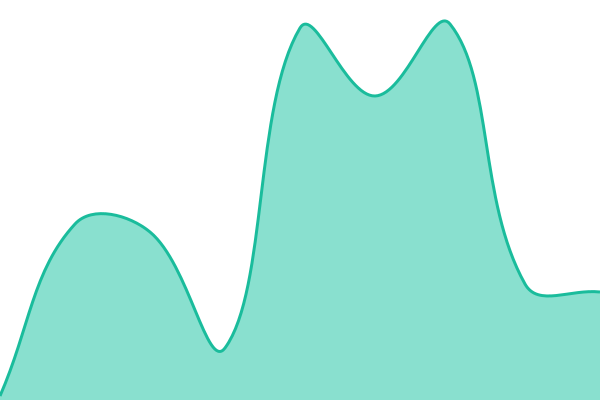

# [📈 Live Status](https://status.fraudcrawler.veanu.ch): <!--live status--> **🟩 All systems operational**

This repository contains the open-source uptime monitor and status page for [veanu](veanu.ch), powered by [Upptime](https://github.com/upptime/upptime).

With [Upptime](https://upptime.js.org), you can get your own unlimited and free uptime monitor and status page, powered entirely by a GitHub repository. We use [Issues](https://github.com/open-veanu/fraudcrawler-status/issues) as incident reports, [Actions](https://github.com/open-veanu/fraudcrawler-status/actions) as uptime monitors, and [Pages](https://status.fraudcrawler.veanu.ch) for the status page.

<!--start: status pages-->
<!-- This summary is generated by Upptime (https://github.com/upptime/upptime) -->
<!-- Do not edit this manually, your changes will be overwritten -->
<!-- prettier-ignore -->
| URL | Status | History | Response Time | Uptime |
| --- | ------ | ------- | ------------- | ------ |
|  [Production: Web app](https://fraudcrawler.veanu.ch/favicon.png) | 🟩 Up | [prod-web.yml](https://github.com/open-veanu/fraudcrawler-status/commits/HEAD/history/prod-web.yml) | 

 472ms
     
 | 

<a href="https://status.fraudcrawler.veanu.ch/history/prod-web">100.00%</a>
    

|  [Production: Backend API](https://confidential-fraudcrawler-backend.fly.dev/health) | 🟩 Up | [prod-backend.yml](https://github.com/open-veanu/fraudcrawler-status/commits/HEAD/history/prod-backend.yml) | 

 349ms
     
 | 

<a href="https://status.fraudcrawler.veanu.ch/history/prod-backend">100.00%</a>
    

|  [Production: Database & Auth](https://hgmlcybbubypbrlcpqaq.supabase.co/auth/v1/health) | 🟩 Up | [prod-supabase.yml](https://github.com/open-veanu/fraudcrawler-status/commits/HEAD/history/prod-supabase.yml) | 

 582ms
     
 | 

<a href="https://status.fraudcrawler.veanu.ch/history/prod-supabase">100.00%</a>
    

|  [Dev/Test: Web app](https://test.fraudcrawler.veanu.ch/favicon.png) | 🟩 Up | [test-web.yml](https://github.com/open-veanu/fraudcrawler-status/commits/HEAD/history/test-web.yml) | 

 1221ms
     
 | 

<a href="https://status.fraudcrawler.veanu.ch/history/test-web">100.00%</a>
    

|  [Dev/Test: Backend API](https://test-confidential-fraudcrawler-backend.fly.dev/health) | 🟩 Up | [test-backend.yml](https://github.com/open-veanu/fraudcrawler-status/commits/HEAD/history/test-backend.yml) | 

 341ms
     
 | 

<a href="https://status.fraudcrawler.veanu.ch/history/test-backend">100.00%</a>
    

|  [Dev/Test: Database & Auth](https://ihpopzebgxgrnyeienkt.supabase.co/auth/v1/health) | 🟩 Up | [test-supabase.yml](https://github.com/open-veanu/fraudcrawler-status/commits/HEAD/history/test-supabase.yml) | 

 695ms
     
 | 

<a href="https://status.fraudcrawler.veanu.ch/history/test-supabase">100.00%</a>
    

|  [Upstream: Vercel](https://www.vercel-status.com/api/v2/status.json) | 🟩 Up | [upstream-vercel.yml](https://github.com/open-veanu/fraudcrawler-status/commits/HEAD/history/upstream-vercel.yml) | 

 128ms
     
 | 

<a href="https://status.fraudcrawler.veanu.ch/history/upstream-vercel">100.00%</a>
    

|  [Upstream: Supabase](https://status.supabase.com/api/v2/status.json) | 🟩 Up | [upstream-supabase.yml](https://github.com/open-veanu/fraudcrawler-status/commits/HEAD/history/upstream-supabase.yml) | 

 243ms
     
 | 

<a href="https://status.fraudcrawler.veanu.ch/history/upstream-supabase">100.00%</a>
    

|  [Upstream: Fly.io](https://status.flyio.net/api/v2/status.json) | 🟩 Up | [upstream-flyio.yml](https://github.com/open-veanu/fraudcrawler-status/commits/HEAD/history/upstream-flyio.yml) | 

 267ms
     
 | 

<a href="https://status.fraudcrawler.veanu.ch/history/upstream-flyio">96.70%</a>
    

<!--end: status pages-->

[**Visit our status website →**](https://status.fraudcrawler.veanu.ch)

## 📄 License

- Powered by: [Upptime](https://github.com/upptime/upptime)
- Code: [MIT](./LICENSE) © [Anand Chowdhary](https://anandchowdhary.com)
- Data in the `./history` directory: [Open Database License](https://opendatacommons.org/licenses/odbl/1-0/)
